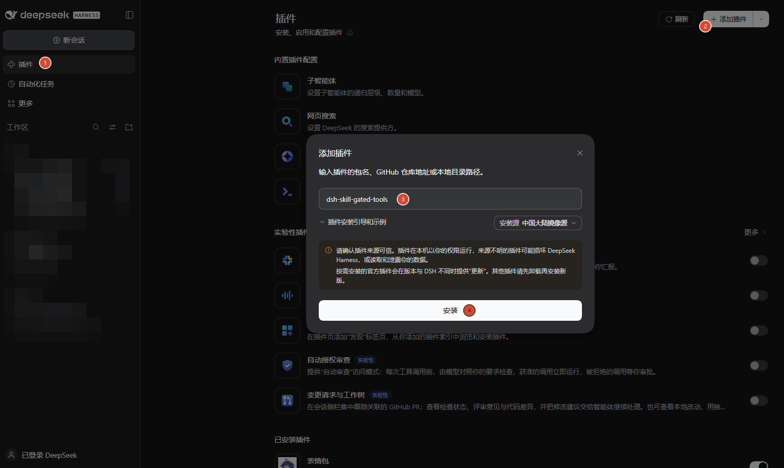
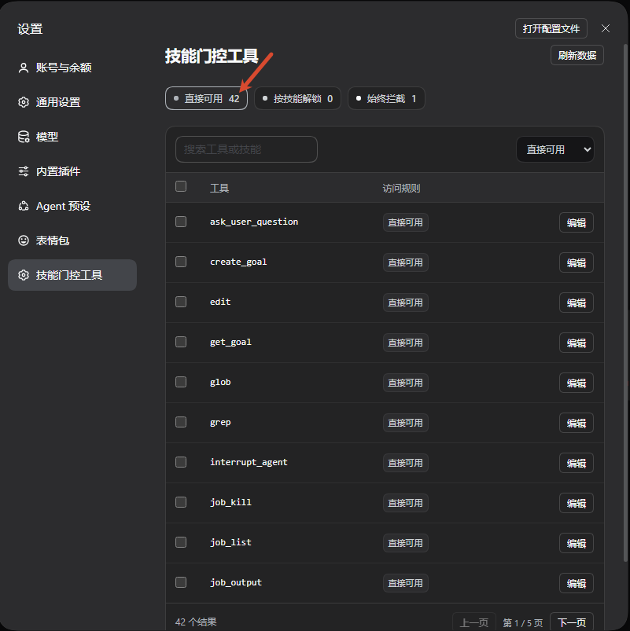
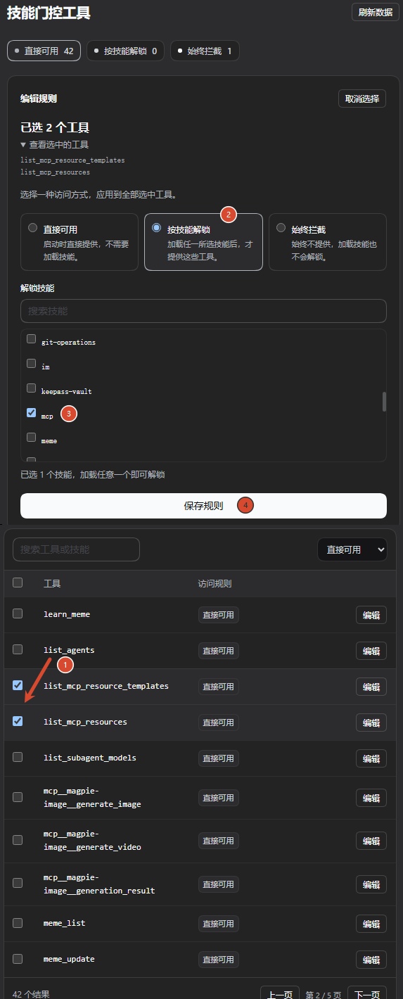
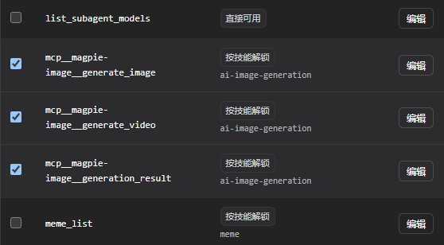
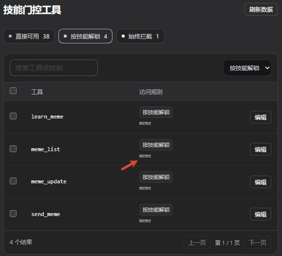
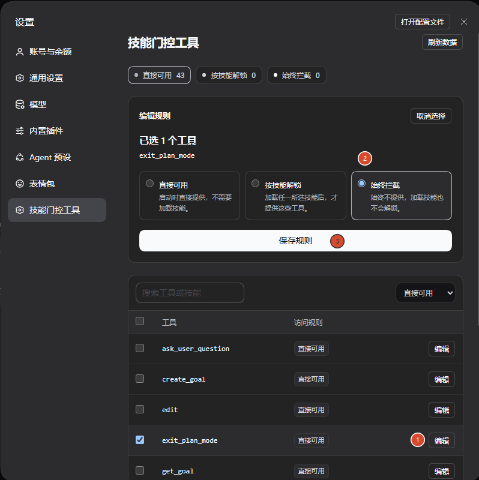
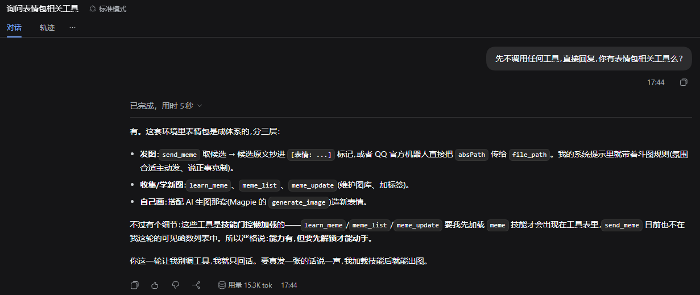
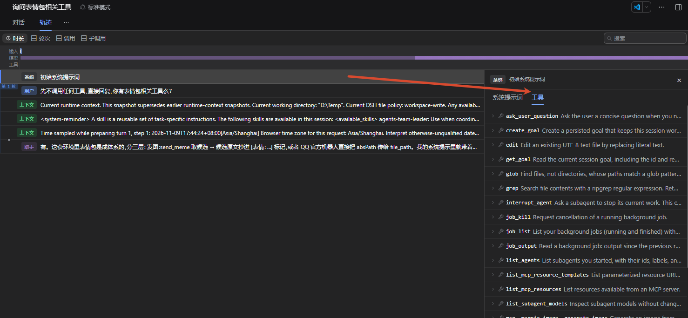
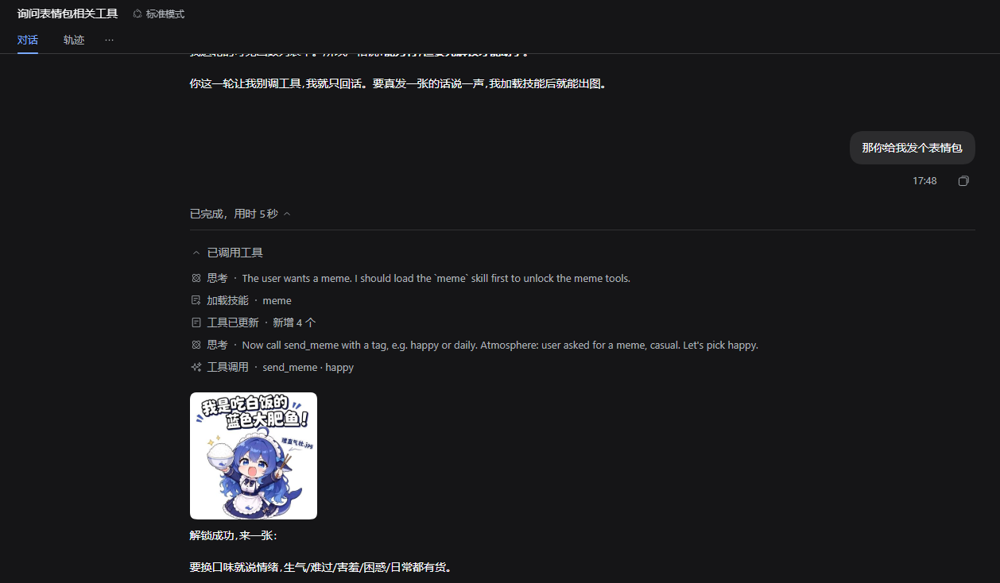

# dsh-skill-gated-tools

[简体中文](README.zh-CN.md)

**Keep specialized tools out of the way. Load a skill to get its guidance and tools together.**

Skill-gated tool discovery for DeepSeek Harness. Supports third-party plugin tools and **MCP tools**, with individual tool rules: a fresh Agent starts with assigned tools hidden, and a successful skill load unlocks them for immediate use in the same turn.

## Why unlock tools through skills?

Many infrequently used tools belong to specific workflows that also need instructions, constraints or examples. Binding those tools to a skill lets one skill load provide both the guidance and the capabilities needed to act on it. General conversations carry fewer specialized tool definitions; a relevant task brings in the corresponding skill and tools.

Tool search follows “search for a capability → discover tools → call them.” This plugin follows “load a task skill → receive its guidance and assigned tools → call them.” For models already familiar with skill loading, reusing that entry point may be more natural, especially when a specialized tool already calls for supporting instructions. **This is a workflow design rationale. We have not run comparative accuracy, latency or cost benchmarks against tool search.**

## Install

Install into the DSH profile where you want the rules to apply. Claude skill discovery requires the official filesystem skill provider from DSH 0.2.2-rc.1 or a compatible version.

For a published npm release in Desktop:

1. Open **Plugins** in the sidebar.
2. Click **Add plugin**.
3. Enter `dsh-skill-gated-tools`.
4. Click **Install**, then enable it as prompted.

Package-name installation requires an npm release. Before registry publication, use the absolute path to the supplied local plugin archive in the same dialog.



For Web / CLI, replace `<web-profile>` with the profile used to start your Web Host. After npm publication, run:

```sh
dsh plugin --profile <web-profile> add dsh-skill-gated-tools
```

For example, if your profile is named `web`:

```sh
dsh plugin --profile web add dsh-skill-gated-tools
```

Web and Desktop can use different profiles and plugin collections. Check which Host you are configuring.

## Configure tool visibility

Open **Settings → Skill-gated tools**. Search or filter the tools, select one or several, choose a policy, and save.

| Policy | What the current Agent sees |
| --- | --- |
| Available | The tool is visible from the start. |
| Skill-gated | The tool appears after a successful load of any assigned skill. |
| Always blocked | The tool stays hidden, even after a skill loads. |

Each Agent unlocks independently; resumed sessions restore successful skill-load history. A tool can be assigned to several skills, and loading any one unlocks it. Blocking takes precedence.

### Preview directly available tools

Click the **Available** filter to preview the tool list provided at the start of a fresh session.



### Select tools and bind a global skill

For example, select the MCP resource tools in the table, choose **Skill-gated**, select the global `mcp` skill, and **Save rules**.



The annotations follow the action order. Because the editor sits above the tool table, their visual order from top to bottom is 2, 3, 4, 1.

### MCP tools are supported

Select MCP tools individually or bind several at once, just like other plugin tools. This example binds image generation, video generation and generation-result retrieval to the `ai-image-generation` skill.



### Inspect existing bindings

Click **Skill-gated** to filter the tools. The **Access rule** column shows their assigned skills.



### Always block a tool

Click **Edit** on the tool row, choose **Always blocked**, and **Save rules**.



Saving updates only selected tools and preserves unrelated rules. Failed saves retain the draft. Reopen a session after changing rules to apply the saved configuration.

## From hidden to immediately usable

After configuration, inspect the actual tool list in a fresh session: tools awaiting a skill and always-blocked tools are absent from the initial list.

<details>
<summary>View the initial tool-list verification screenshots</summary>





</details>

When the user asks for a meme, the Agent loads `meme`, the tool list updates, and it calls `send_meme` in the same turn. Newly unlocked tools do not require a new session.



## Ask an Agent to configure rules

The plugin registers the bundled **skill-gated-tools** configuration skill. For example:

> Load the skill-gated-tools skill. Bind send_meme to the meme skill and preserve all other rules.

The guide helps the Agent inspect the real catalog, update the requested rules, and read back the result.

**Give unlocking skills informative descriptions.** Include relevant tasks, representative tool names, and a clear instruction to load the skill first. The Agent can find the entry in its skill catalog while the tools are still hidden. For example, a description for `meme` could say:

> Find and send memes. Before using send_meme or related meme tools, load this skill to unlock them.

Update a local skill's `description`, or the registration description supplied by its plugin. This plugin does not automatically rewrite other skills.

## Does lazy loading affect the KV cache?

**It depends on the model protocol and the DSH adapter.** This plugin lifts tool-visibility restrictions; DSH determines how the definitions enter model requests.

Cache reuse relies on an unchanged prompt prefix. Routes supporting in-conversation updates can append newly available tools and context after existing history, preserving the unchanged prefix. Other routes may rewrite leading tool definitions and lose reuse from the first changed token. New content still needs processing, and fewer initial tool definitions do not establish a measured cost or latency improvement.

<details>
<summary>Official sources and applicability</summary>

- [DSH Agent Loop](https://github.com/deepseek-ai/deepseek-harness/blob/master/packages/core/agent-loop/README.md#model-experience) documents prompt appends, tool-update capabilities and prefix reuse. The [adapter capability resolver](https://github.com/deepseek-ai/deepseek-harness/blob/master/packages/llm/llm-pi-ai/src/models.ts) enables this path per model and protocol.
- DSH's [default DeepSeek catalog](https://github.com/deepseek-ai/deepseek-harness/blob/master/packages/llm/llm-deepseek/src/models.ts) declares `systemPromptUpdate: 'in-history'` and `toolUpdate: 'addition-only'` for `deepseek-flash`. A live service catalog or custom route may differ; this does not establish support for every DeepSeek model.
- [OpenAI Tool Search](https://developers.openai.com/api/docs/guides/tools-tool-search) explicitly places discovered tools at the end of context to preserve caching on supported Responses models, documented from GPT-5.4 onward. This does not establish support for ordinary Chat Completions or arbitrary compatible gateways.
- [Anthropic Advanced Tool Use](https://www.anthropic.com/research/advanced-tool-use) also describes cache preservation for its native deferred tool-search protocol.
- [OpenAI Prompt Caching](https://developers.openai.com/api/docs/guides/prompt-caching) explains KV state and matching prefixes. An eligible reusable prefix is not a guarantee of a cache hit; provider policy and actual requests still matter.

Tool search and skill gating are different discovery entry points. Cache behavior depends on the underlying request protocol. This project has not benchmarked their comparative cache savings. See the [technical research note](docs/tool-loading-and-cache.md).

</details>

## Skill directories and rule storage

Use global skills from `~/.dsh/skills`, `~/.agents/skills` and `~/.claude/skills`, alongside existing project and custom roots. DSH/Agents homes follow host configuration. Claude uses `CLAUDE_CONFIG_DIR/skills` when set, otherwise its default root. The official Claude filesystem provider acts as a fallback for duplicate names. Optional roots may be absent; discovery and loading use the same registry.

Each profile defaults to `<profile directory>/skill-gate/bindings.json`; the bottom of Settings shows the effective path. Independent profiles can keep separate rules; windows connected to the same Host share that Host's rules. `bindingPath` overrides the default.

The legacy `<dsh home>/skill-gate/bindings.json` is retained. If the current profile has no rule file, **Import legacy rules** explicitly copies it without changing the source. Desktop rules are not automatically copied to another profile. Profiles deliberately pointing `bindingPath` at one file share its rules.

Removed skills or plugins leave editable rules. Unresolved references produce feedback without blocking unrelated saves. Rules are not automatically deleted or relaxed; preserved rules apply again when their referenced items return.

<details>
<summary>Rule format and API</summary>

Example for a Host with the meme plugin installed:

```json
{
  "version": 1,
  "blockedTools": [],
  "bindings": [
    { "skill": "meme", "tools": ["send_meme"] }
  ]
}
```

- `GET /skill-gate`: read the catalog, saved rules and warnings.
- `GET /skill-gate/bindings`: read the rule document.
- `PUT /skill-gate/bindings`: update bindings; omitting `blockedTools` preserves the stored block list.
- `POST /skill-gate/bindings/import-legacy`: import when the current profile has no rule file.

Requests use the Host's connection checks.

</details>

## Development

Use Node.js 24 and pnpm 11.

```sh
pnpm install --frozen-lockfile
pnpm typecheck
pnpm test
pnpm build
pnpm test:artifact
```

Artifact tests load the built Host entry against real DSH services. Use an isolated DSH Web Host with a separate home, profile and fixture data for UI work.

## License

[MIT](LICENSE). See [third-party notices](THIRD_PARTY_NOTICES.md) for upstream code and assets shown in screenshots.
