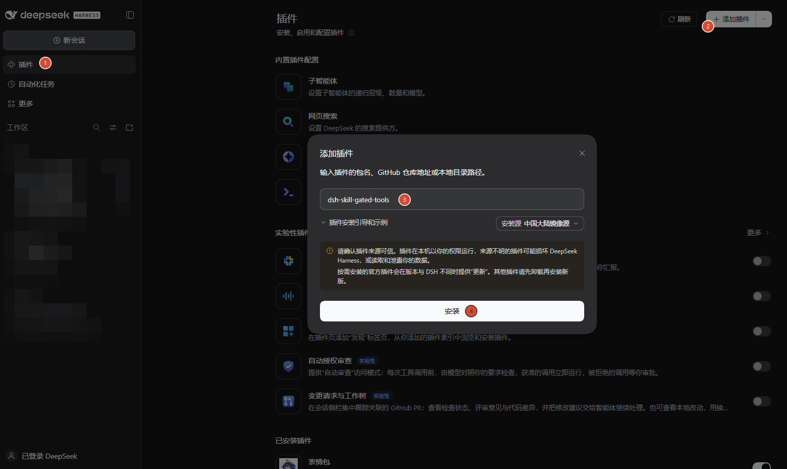
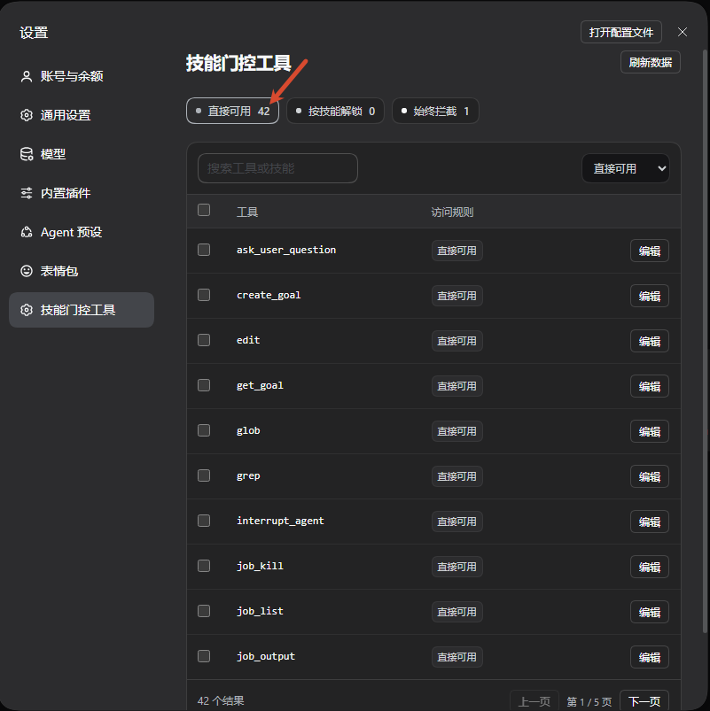
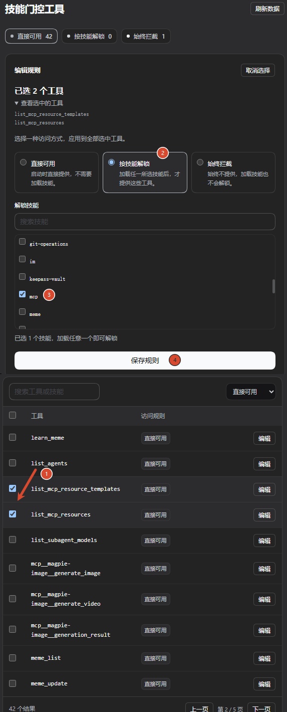
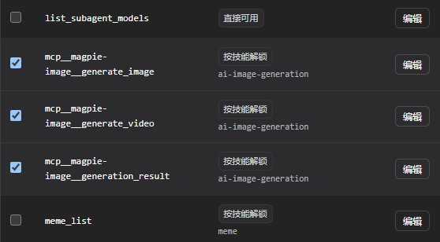
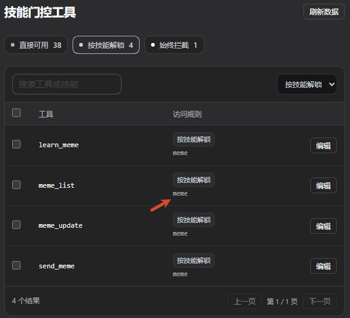
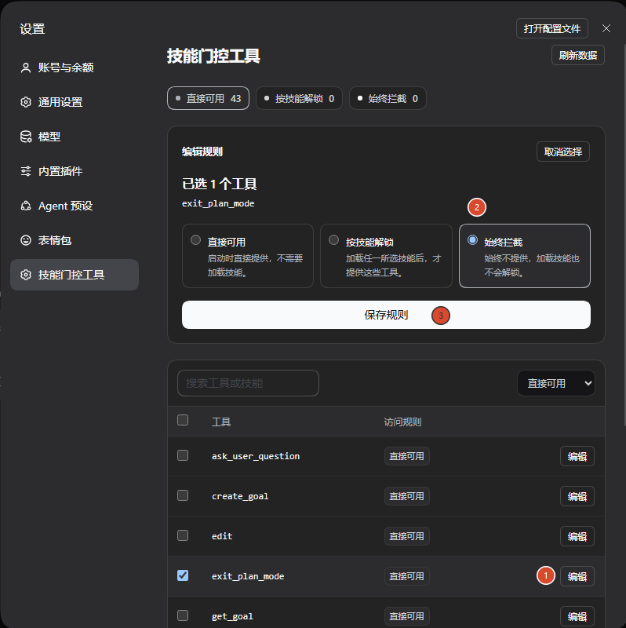
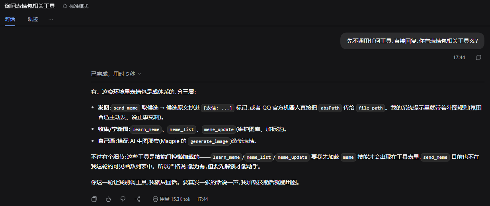
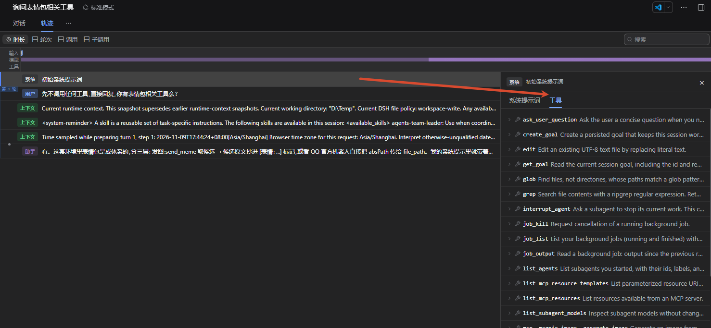
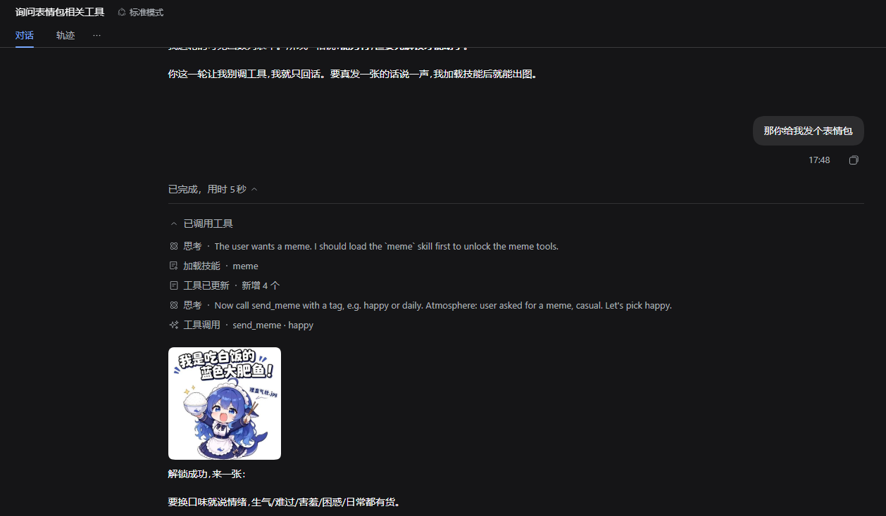

# dsh-skill-gated-tools

[English](README.md)

**平时收起专用工具，需要时，一次加载技能与工具。**

为 DeepSeek Harness 提供按技能解锁的工具可见性管理。支持第三方插件工具和 **MCP 工具**，按单个工具配置：新 Agent 开始时隐藏已绑定的工具，成功加载对应技能后自动解锁，并可在同一轮继续调用。

## 为什么用技能解锁工具

许多低频工具都有特定使用场景，使用时也需要操作流程、约束或示例。把这些工具绑定到技能，Agent 加载技能时就能同时得到“怎么做”和“用什么做”：日常对话减少专用工具定义占用，进入对应场景，再按需加载。

工具搜索走“搜索能力 → 发现工具 → 调用”的路线；本插件走“加载场景技能 → 同时获得指导和绑定工具 → 调用”的路线。对于已经熟悉技能调用的模型，沿用技能入口可能更顺手，尤其适合本来就需要配套技能的专用工具。**这是工作流设计上的判断，目前没有与工具搜索进行准确率、延迟或成本的对比实验。**

## 安装

安装到需要使用本插件的 DSH profile。Claude 技能目录接入需要 DSH 0.2.2-rc.1 或兼容版本的官方文件系统技能 provider。

Desktop 的 npm 版本安装方式：

1. 打开左侧 **插件**。
2. 点击 **添加插件**。
3. 输入 `dsh-skill-gated-tools`。
4. 点击 **安装**，安装完成后按界面提示启用。

按包名安装以该版本已经发布到 npm 为前提；发布前可在同一入口填写提供的本地插件压缩包绝对路径。



Web / CLI：把 `<web-profile>` 替换为启动 Web 时实际使用的 profile 名称。npm 发布后执行：

```sh
dsh plugin --profile <web-profile> add dsh-skill-gated-tools
```

例如，使用 `web` profile 时：

```sh
dsh plugin --profile web add dsh-skill-gated-tools
```

Web 与 Desktop 可以使用不同的 profile 和插件集合，配置前先确认当前连接的 Host。

## 配置工具可见性

打开 **设置 → 技能门控工具**。搜索或筛选工具，选择一个或多个工具，再设置策略并保存。

| 策略 | 当前 Agent 会看到什么 |
| --- | --- |
| 直接可用 | 工具从开始就可见，门控不隐藏它。 |
| 按技能解锁 | 成功加载任一绑定技能后，工具才出现。 |
| 始终拦截 | 工具始终隐藏，加载技能也不会解锁。 |

每个 Agent 独立解锁；恢复会话时会恢复已有的成功技能加载记录。一个工具可以绑定多个技能，加载其中任意一个即可解锁；始终拦截优先于技能绑定。

### 预览直接可用的工具

点击 **直接可用** 筛选标签，预览新会话开始时直接提供给 Agent 的工具列表。



### 多选工具，绑定全局技能

以 MCP 资源工具为例：先在工具列表中多选目标工具，再选择 **按技能解锁**，勾选全局技能 `mcp`，点击 **保存规则**。



图中标号保留操作顺序；设置面板位于工具列表上方，因此从上到下显示为 2、3、4、1。

### 支持 MCP 工具

MCP 工具与其他插件工具一样，可以逐个选择，也可以批量绑定。下图把图像生成、视频生成和生成结果查询的 MCP 工具绑定到 `ai-image-generation` 技能。



### 查看已有绑定

点击 **按技能解锁** 筛选标签，在 **访问规则** 列中查看每个工具绑定的技能。



### 始终拦截工具

对于不希望 Agent 使用的工具，点击该行的 **编辑**，选择 **始终拦截**，再点击 **保存规则**。



保存只更新所选工具，保留其他规则；保存失败时保留草稿。修改规则后，重开会话应用已保存的配置。

## 从隐藏到即时可用

配置完成后，在新会话的实际工具列表中核对：待技能解锁和始终拦截的工具不出现在初始列表中。

<details>
<summary>查看初始工具列表的验证截图</summary>





</details>

当用户需要表情包时，Agent 加载 `meme` 技能，界面提示工具列表新增，再在同一轮调用 `send_meme`。无需另开会话来使用刚解锁的工具。



## 让 Agent 帮你配置

插件内置 **skill-gated-tools** 配置技能，随插件注册，可直接加载。例如：

> 加载 skill-gated-tools 技能，把 send_meme 绑定到 meme 技能，保留其他规则。

该技能指导 Agent 查看真实目录、修改指定规则并回读结果。

**建议同步优化负责解锁工具的技能描述。** 写清适用场景、代表性工具名，并提示使用前先加载该技能。工具仍隐藏时，Agent 就能从技能目录找到入口。例如 `meme` 的描述可以写成：

> 用于查找和发送表情包；需要使用 send_meme 等表情工具时，先加载本技能以解锁工具。

本地技能在 `description` 中维护；插件提供的技能从其注册描述来源维护。本插件不会自动改写其他技能。

## 懒加载会影响 KV cache 吗

**取决于模型接口和 DSH 适配器如何更新工具。** 本插件负责解除工具的可见性限制，工具定义如何进入模型请求由 DSH 处理。

缓存复用依赖不变的提示词前缀。支持对话内追加更新的路由，可以在已有历史后追加新工具及上下文，保留未改变的前缀；不支持时，修改开头的工具定义仍可能使缓存从首个变化处失配。新增内容本身仍需处理，减少初始工具定义也不等于已经测得费用或延迟下降。

<details>
<summary>官方依据与适用条件</summary>

- [DSH Agent Loop](https://github.com/deepseek-ai/deepseek-harness/blob/master/packages/core/agent-loop/README.md#model-experience) 说明追加提示词、工具更新能力与缓存前缀的关系；[适配器能力判断](https://github.com/deepseek-ai/deepseek-harness/blob/master/packages/llm/llm-pi-ai/src/models.ts) 按具体模型和协议启用该路径。
- DSH 的 [DeepSeek 默认目录](https://github.com/deepseek-ai/deepseek-harness/blob/master/packages/llm/llm-deepseek/src/models.ts) 为 `deepseek-flash` 声明 `systemPromptUpdate: 'in-history'` 与 `toolUpdate: 'addition-only'`。实际服务目录或自定义路由可以有不同能力，不能推广到所有 DeepSeek 模型。
- [OpenAI Tool Search](https://developers.openai.com/api/docs/guides/tools-tool-search) 明确说明：支持的 Responses 模型把新发现的工具放在上下文末尾以保留缓存；文档标注从 GPT-5.4 起支持该能力。普通 Chat Completions 或任意兼容网关不能据此推定支持。
- [Anthropic Advanced Tool Use](https://www.anthropic.com/research/advanced-tool-use) 也说明其原生延迟工具搜索可保留系统提示词和核心工具的缓存。
- [OpenAI Prompt Caching](https://developers.openai.com/api/docs/guides/prompt-caching) 解释 KV 状态与相同前缀复用。保留可复用前缀不等于每次请求都必然命中，仍受供应商缓存策略与实际请求影响。

工具搜索与技能解锁是发现能力的不同入口；缓存是否保留由底层请求协议决定。本项目尚未进行两种路线的缓存收益对比实验。完整调研见[缓存机制说明](docs/tool-loading-and-cache.md)。

</details>

## 技能目录与规则存储

支持宿主技能目录中的全局根 `~/.dsh/skills`、`~/.agents/skills` 与 `~/.claude/skills`，保留项目及自定义目录。DSH/Agents 遵循宿主配置；设置 `CLAUDE_CONFIG_DIR` 时，Claude 根为其下的 `skills`。Claude 通过官方 provider 接入，同名技能已有其他来源时作为后备。目录可选，设置页发现和实际加载共用技能注册表。

每个 profile 默认保存到 `<profile 目录>/skill-gate/bindings.json`，设置页底部显示实际路径。不同 profile 可独立配置；连接同一 Host 的多个窗口共用该 Host 的规则。`bindingPath` 可覆盖默认路径。

旧的 `<dsh home>/skill-gate/bindings.json` 保留。当前 profile 尚无规则文件时，可通过 **导入旧规则** 显式复制，原文件不变；不会自动把 Desktop 规则复制到另一个 profile。若通过 `bindingPath` 共用同一文件，各 profile 也会共用规则。

删除技能或卸载插件后，原规则仍可编辑、保存或删除。设置页提示未解析引用；不会自动清理或放开策略，对应项恢复后规则重新生效。

<details>
<summary>规则格式与接口</summary>

以下示例适用于安装了表情包插件的 Host：

```json
{
  "version": 1,
  "blockedTools": [],
  "bindings": [
    { "skill": "meme", "tools": ["send_meme"] }
  ]
}
```

- `GET /skill-gate`：读取目录、规则和提示。
- `GET /skill-gate/bindings`：读取绑定文档。
- `PUT /skill-gate/bindings`：更新绑定；省略 `blockedTools` 保留原屏蔽列表。
- `POST /skill-gate/bindings/import-legacy`：当前 profile 尚无规则文件时导入旧规则。

接口沿用宿主连接校验。

</details>

## 开发

使用 Node.js 24 和 pnpm 11。

```sh
pnpm install --frozen-lockfile
pnpm typecheck
pnpm test
pnpm build
pnpm test:artifact
```

产物测试通过真实 DSH 服务检查构建后的 Host 入口。界面开发使用独立 DSH Web Host 与隔离的 home、profile、测试数据。

## 社区

认可并感谢 [LINUX DO](https://linux.do/) 社区对开源交流与分享的支持。

## 许可证

[MIT](LICENSE)。上游代码与截图中第三方素材的许可说明见[第三方声明](THIRD_PARTY_NOTICES.md)。
